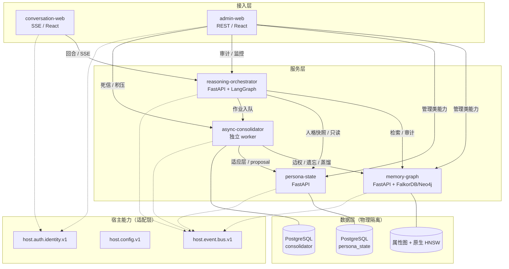
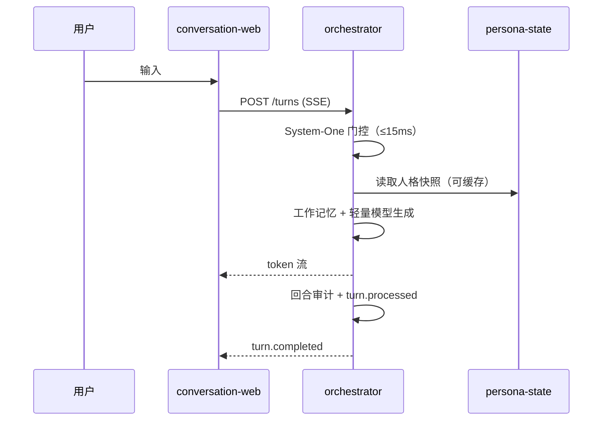
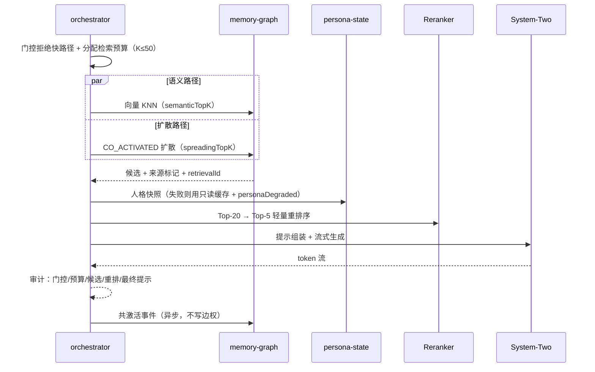
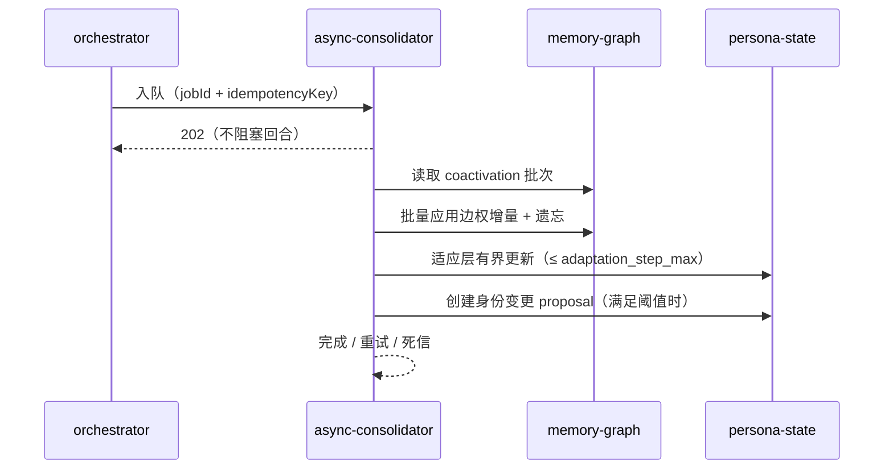

# HLA-MEM 架构说明

> 本文是两份输入文档的**归一化架构摘要**，不替代原文。命名、职责与数据边界的冲突已在 [contract-alignment.md](contract-alignment.md) 中裁决；量化门槛以《HLM-MEM开发计划》第 2 节为准。

## 1. 系统定位

HLA-MEM 把“记忆”与“人格”拆成两类状态：

- **记忆图**：情景（Episode）与概念（Concept）为节点，共激活（`CO_ACTIVATED`）为带权边；检索同时走**语义相似**与**Hebbian 扩散**两条路径，合并去重后交给编排器重排序。
- **人格状态**：**身份层**（稳定、版本化、禁止自动写入）与**适应层**（有界、可被巩固更新）分离；经历日志只追加；身份变更通过 proposal 人工闸门。
- **异步巩固**：对话回合只做轻量入队；边权更新、遗忘、枢纽蒸馏、适应层更新在独立 worker 中执行，不阻塞用户可见响应。

## 2. 模块与分层



### 2.1 分层与依赖方向

每个后端模块内部固定四层：

```text
api → application → domain
                 ↑
          infrastructure（实现 domain/application 定义的端口）
```

- `domain`：实体、值对象、纯业务规则；不依赖 FastAPI、数据库驱动、消息 SDK。
- `application`：用例编排、事务边界、授权执行点；调用 domain 与端口。
- `api`：HTTP/SSE 适配、DTO 映射、错误码；只做装配与转发。
- `infrastructure`：存储、事件总线、模型、队列适配器；可替换。

### 2.2 跨模块调用矩阵

| 调用方 → 被调方 | memory-graph | persona-state | reasoning-orchestrator | async-consolidator |
| --- | --- | --- | --- | --- |
| conversation-web | — | — | 回合（SSE） | — |
| admin-web | `graph.read` | `identity.*` / `proposal.review` | `audit.read` | `deadletter.*` / `backlog.read` |
| reasoning-orchestrator | `episode.retrieve` / `retrieval.read` | `identity.read` / `adaptation.read` | — | `job.enqueue` |
| async-consolidator | 边权/遗忘/蒸馏（内部写能力） | `adaptation.update` / `proposal.create` | — | — |

所有箭头都是**能力调用**；不存在共享数据库、共享事务或跨模块内部包引用。

## 3. 关键请求流

### 3.1 快路径（System-One 命中，目标 P50 ≤ 400ms）



快路径**不触发**图检索与完整 System-Two 生成；门控在本地规则/分类器完成，不调用 LLM。

### 3.2 慢路径（目标 P50 ≤ 1.2s，P95 ≤ 2.5s）



### 3.3 异步巩固闭环



### 3.4 降级矩阵

| 故障 | 受影响路径 | 降级行为 | 不得发生 |
| --- | --- | --- | --- |
| memory-graph 超时/不可用 | 慢路径 | 跳图检索，使用人格 + 工作记忆；`memoryDegraded=true`；审计记录原因 | 伪造记忆命中；写边权 |
| persona-state 不可用 | 快/慢路径 | 使用最近一次成功读取的只读身份摘要（TTL），`personaDegraded=true`；拒绝需要写人格的动作 | 用缓存覆盖拒绝结果；自动写身份层 |
| LLM 首 token 超时 | 慢路径 | SSE `error` 事件 + 不完整标记；不伪造完成 | 把超时包装成成功 |
| 巩固作业失败 | 异步 | 有限重试 → 死信；可查询/重放 | 无限重试；占用对话配额 |
| 向量索引不可用 | 慢路径 | 降级为图路径或返回受控 503；标记来源 | 返回未标来源的候选 |
| 管理端能力缺失 | 管理端 | 隐藏/禁用相关功能；后端仍拒绝 | 仅靠前端隐藏 |

## 4. 量化约束（阶段门槛）

| 约束 | 目标 | 验证阶段 |
| --- | --- | --- |
| 快路径 P50 | ≤ 400ms | 阶段 2 |
| 慢路径 P50 / P95 | ≤ 1.2s / ≤ 2.5s | 阶段 2 |
| 检索 P95（10 万节点） | ≤ 300ms | 阶段 1 |
| System-One 门控决策 | ≤ 15ms | 阶段 2 |
| 异步巩固对回合阻塞 | 0 | 阶段 3 |
| 双路径 Recall@20 增益 | ≥ 单语义路径 +10pp | 阶段 1 |
| 共激活事件幂等 | `pairId + batchId` 去重 | 阶段 1 |
| 身份层自动写入 | 禁止 | 阶段 3 |
| 适应层单次变化 | ≤ `adaptation_step_max` | 阶段 3 |

测量方法、数据集与基准脚本在阶段 1/2 补齐；数值未达标不得进入下一阶段。

## 5. 横切关注点

### 5.1 安全与租户

- 身份唯一来源是宿主 `host.auth.identity.v1`；模块不自建账号/令牌。
- `tenantId` 从可信身份上下文注入，写入所有图节点、人格记录、作业与审计；请求体/query/普通头中的租户字段一律忽略并视为非法。
- 所有入口（HTTP、CLI、消息、后台任务）执行同一套 `require_permission`；未知入口/权限默认拒绝。
- 管理端只调用模块管理能力；前端可见性不替代后端校验。
- 事件不携带记忆原文/人格内容/凭据；只带引用 ID 与元数据。

### 5.2 可观测性

- 每个后端模块：`/internal/health`（存活）、`/internal/ready`（依赖+配置就绪）、`/internal/metrics`（Prometheus 文本）。
- 指标至少覆盖：请求量/耗时/错误率、依赖调用、事件发布失败、消费延迟、积压、死信、后台作业。
- 日志：结构化 JSON，含 `timestamp`、`level`、`service`、`module`、`requestId`、`traceId`、稳定错误码；敏感字段脱敏。
- 审计：身份层变更、proposal 审批、死信重放、管理端写操作全部留痕（主体、动作、对象、结果、requestId）。

### 5.3 配置

- 键名加模块前缀（如 `memory-graph.store.dsn`）；环境变量映射为 `HLA_<MODULE>_<KEY>`。
- 每项声明类型、默认值、是否敏感、是否可动态修改、作用范围；敏感值只在启动时读取，不写日志/事件。
- 必选配置缺失时 `/internal/ready` 失败并给出可操作诊断，不带病启动。

### 5.4 版本与兼容

- 模块版本 `0.1.0` 起步；能力/事件 v1；宿主兼容 `>=0.1.0 <1.0.0`。
- 破坏性变更升主版本并保留迁移期；事件 `dataVersion` 递增，消费者需容忍新增字段。
- OpenAPI 由实现导出并提交，CI 检查漂移；事件 Schema 与 `module.yaml` 同版本管理。

## 6. 部署与运行（阶段 0–1）

```text
开发机
├── 4 个 FastAPI 进程（8081–8084）
├── 1 个 Web 服务（4173：/conversation + /admin 同源）
├── FalkorDB（6379）
├── PostgreSQL persona_state（5432）
└── PostgreSQL consolidator（5433）
```

阶段 0–2 使用单机 Compose，不引入 Kubernetes。阶段 3–4：orchestrator 无状态按并发扩容；consolidator 有状态按积压扩容；图库与人格库独立部署，不随应用进程伸缩。SSE 链路不得经过缓冲响应的网关。

> 当前开发机没有 Docker：上述容器拓扑与迁移均**未验证**；阶段 0 只提交 Compose 与迁移声明，阶段 1 需在具备 Docker 的环境完成验收。
